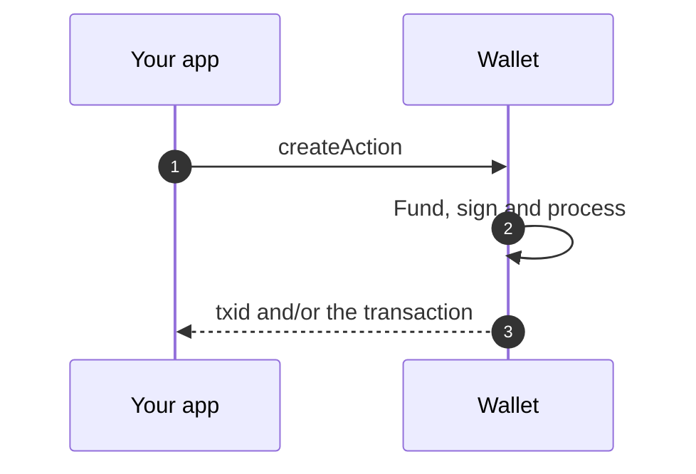

import CreateActionFlow from '/snippets/diagrams/CreateActionFlow.jsx';
import StackLayers from '/snippets/diagrams/StackLayers.jsx';

This is a draft page for reviewing diagram outputs. It is not part of the documentation. Each sample uses real content from this portal.

## Static images in a light and dark pair

These are generated by `diagrams/scripts/build-svg.mjs` from one small spec each, with the colors from `tokens.json`. Both files have the same geometry, only the colors change, and the image is 720 pixels wide so it fits the text column. The page shows the dark version in dark mode.

### Process flow

A fixed sequence of steps, with a failure path. Use it for pipelines and ordered checks.

<Image src="/images/diagrams/sample-flow-spv.light.svg" srcDark="/images/diagrams/sample-flow-spv.dark.svg" size="720px" alt="SPV verification of a BEEF package in four steps: read the Merkle proofs, check them against block headers, validate the ancestor transactions, then evaluate the transaction. If any check fails, verification stops." />

### Sequence

Who calls whom, in order, with the return messages. Use it for request and response flows between systems.

<Image src="/images/diagrams/sample-sequence-request.light.svg" srcDark="/images/diagrams/sample-sequence-request.dark.svg" size="720px" alt="Sequence of a createAction request on desktop. The app calls createAction on WalletClient, which reaches the wallet over a local channel. The wallet may call shared services for proofs and broadcast, signs locally, and the result returns through WalletClient to the app." />

### Layered architecture

Layers with the packages inside them, and the boundary between layers. Use it for stack and architecture overviews.

<Image src="/images/diagrams/sample-architecture-stack.light.svg" srcDark="/images/diagrams/sample-architecture-stack.dark.svg" size="720px" alt="The BSV stack as four layers. The application layer (@bsv/simple/browser and @bsv/simple/server) sits above the BRC-100 wallet interface, which sits above the wallet toolkit (@bsv/wallet-toolbox), which sits on @bsv/sdk, the foundation." />

### Lifecycle

States and the transitions between them, with the status colors: neutral, success, pending and info. Use it for things that move through states.

<Image src="/images/diagrams/sample-lifecycle-createaction.light.svg" srcDark="/images/diagrams/sample-lifecycle-createaction.dark.svg" size="720px" alt="The outcomes of a createAction call. The wallet either finishes alone (immediate action) or returns a signable action. For a signable action, the app signs and calls signAction. Both paths end with a finished transaction." />

### Decision flow

Questions that lead to one answer. Use it to help readers choose between options.

<Image src="/images/diagrams/sample-decision-package.light.svg" srcDark="/images/diagrams/sample-decision-package.dark.svg" size="720px" alt="Choosing a package. If you are building a wallet, use @bsv/wallet-toolbox. Otherwise, if the user holds the keys, use @bsv/simple/browser. If your own backend or agent holds the key, use @bsv/simple/server." />

### Swimlane

Two actors in separate lanes, with a branch. Use it when it matters who does each step.

<Image src="/images/diagrams/sample-swimlane-createaction.light.svg" srcDark="/images/diagrams/sample-swimlane-createaction.dark.svg" size="720px" alt="Swimlane of a createAction call. The app calls createAction. The wallet checks the request. If it can finish alone, it returns the result. If not, it returns a signable transaction, the app signs and calls signAction, and the wallet returns the result." />

## Live diagrams

These are drawn in the browser, so they adapt to the theme and the page width and can be interactive.

### Mermaid

Text-based and rendered by the portal with its own theme. Use it for simple sequences and flows that change together with the API.

### Step-through swimlane

Interactive: the reader goes step by step and the active box is highlighted. Use it for a flow that is easier to follow one step at a time.

<Visibility for="agents">
The diagram has seven steps and two paths. First, the app calls `createAction`. Second, the wallet checks whether it can fund, sign and process the transaction on its own. Path 1, immediate action: the wallet finishes alone and returns a `txid` and/or the transaction itself. Path 2, signable action: the wallet returns `signableTransaction: { tx, reference }` to the app, the app signs its inputs and calls `signAction` to finish. On both paths the wallet then returns the result, and the app uses it.
</Visibility>

<CreateActionFlow />

### Layered architecture component

The same kind of figure as the static one, but built from HTML so it reflows on narrow screens and can hold links.

<Visibility for="agents">
The diagram has four layers, from the top. Application layer: `@bsv/simple/browser` and `@bsv/simple/server`. Below it, the BRC-100 wallet interface is the boundary between app code and wallet code. Wallet toolkit: `@bsv/wallet-toolbox`, storage providers, `WalletSigner` and `Services`, and `Monitor` and key managers. Foundation: `@bsv/sdk`, used by every layer above.
</Visibility>

<StackLayers />
