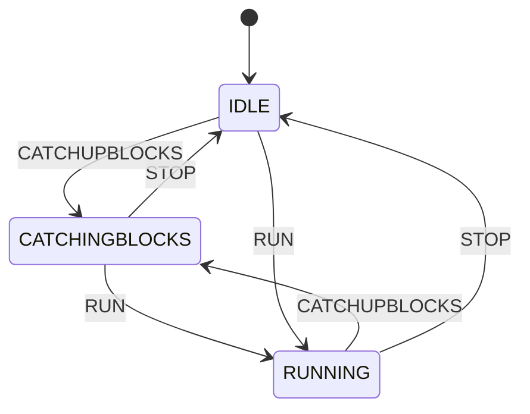

{/* Imported from https://github.com/bsv-blockchain/teranode/blob/06640271112f6c97de6cae93cc8b442ce7379c68/docs/state-machine.diagram.md by scripts/import-teranode.mjs. Do not edit this file: change the source in the Teranode repository, then rerun the script. */}

The mermaid diagram outlined below represents the various states and events that dictate the functionality of the node. To create and visualize the state machine diagram, you can use [https://mermaid.live/](https://mermaid.live/). This tool allows you to generate the diagram visualization interactively.

